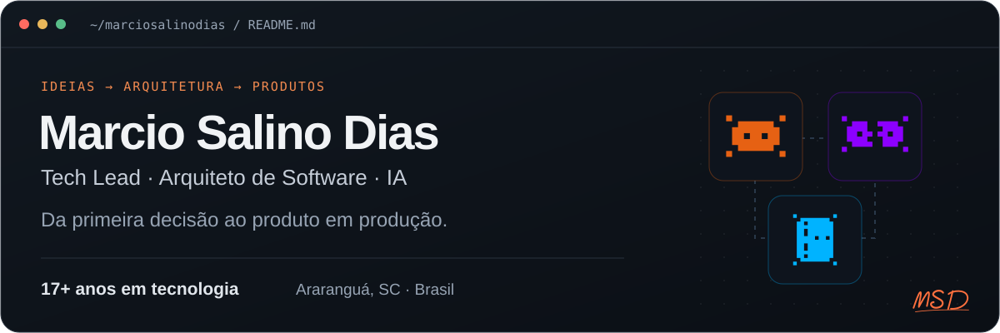
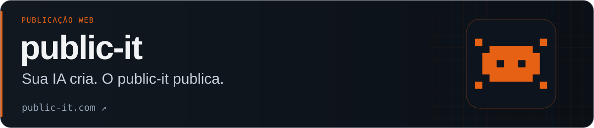
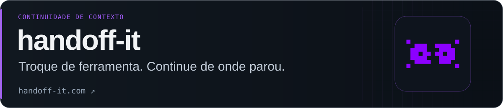
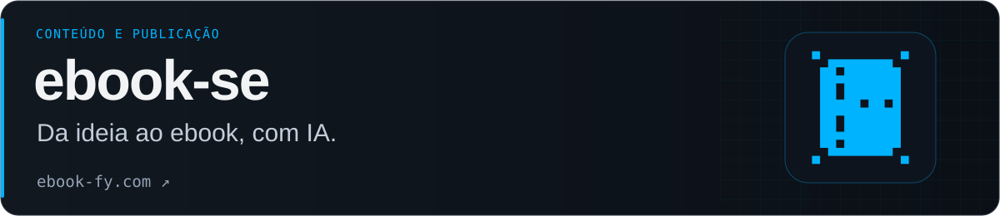

**Tech Lead · Arquitetura de Software · Inteligência Artificial · Full-Stack**

Sou Marcio Salino Dias. Há mais de 17 anos, conecto estratégia, arquitetura e desenvolvimento para transformar ideias em produtos e evoluir sistemas que já fazem parte do dia a dia das empresas.

Hoje, meu foco está em **transformação digital com IA**, liderança técnica e construção de produtos próprios. Gosto de pensar no todo, entender o problema e participar da construção até a solução entrar em produção.

**[Portfólio e currículo](https://marciosalinodias.github.io/)** · **[Trabalhe comigo](https://marciosdias.public-it.com/)** · **[LinkedIn](https://www.linkedin.com/in/marcio-salino-dias)**

## Produtos que estou construindo

Uma família de ferramentas para criar, publicar e continuar o trabalho com IA.

**[public-it](https://public-it.com/)** — Publicação de sites e páginas criados com IA. Conecte sua ferramenta por MCP, envie HTML ou um ZIP e compartilhe uma URL de verdade.

**[handoff-it](https://handoff-it.com/)** — Continuidade de contexto entre ferramentas e máquinas. Preserve conversas, decisões e próximos passos para retomar o trabalho com IA.

**ebook-se** — Criação de ebooks com IA: do tema e do público ao conteúdo, à identidade visual e a uma publicação paginada para ler e compartilhar.

## Como posso ajudar

- **Transformação digital com IA:** aplicar IA aos processos e aos produtos do seu negócio.
- **Consultoria tecnológica e arquitetura:** modernizar sistemas, organizar prioridades e apoiar decisões técnicas.
- **Sites e software sob medida:** construir páginas, integrações, sistemas e produtos digitais.

Trabalho com **TypeScript, JavaScript, React, Next.js, Node.js, PostgreSQL, APIs e MCP**, escolhendo a abordagem conforme o problema.

**[Vamos conversar sobre o seu próximo projeto →](https://marciosdias.public-it.com/)**
